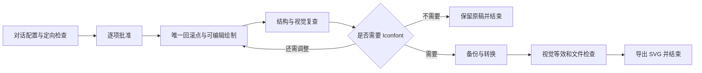

# Figma Monochrome Icons

通过对话在 **Figma Web** 绘制和修订单色矢量图标：线性、面性、光学平衡，以及用户明确需要时的 Iconfont SVG 处理与导出。

用户只需提供链接、参考图和设计意图。首次配置、补充新类型和验收决定都在对话内完成，不需要编辑 Markdown 或使用外部表单。

## 能做什么

- 接入已有图标库，或经批准建立最小的图标基础资产。
- 定向查重和抽样，复用现有尺寸、语义色、栅格与辅助线。
- 用原生可编辑几何绘制图标，保留参数和必要布尔结构。
- 比较100%辨识度、放大细节及同组视觉重量。
- 绘制复查后询问是否需要 Iconfont：不需要就结束，需要才备份、处理并导出。

仅适用于单色线性/面性矢量。多色、渐变、位图、插画以及应用页面实现不在范围内。彩色参考可以在用户同意后用于单色重绘。

## 使用前准备

需要支持 Agent Skills 的宿主，以及可访问目标云端文件的 Figma 工具、Figma Web、版本历史和截图能力。Skill 提供流程，不会自动安装 Figma 连接器或取得文件权限。

普通网页聊天中只粘贴仓库地址不会自动获得本地 Skill 和 Figma 编辑能力；原生问答能力以实际宿主提供的工具为准，没有时使用普通聊天。SVG 检查脚本需要 Python 3.10+，只用标准库。

## 安装到本地 Codex

在 Codex 对话中请求：

```text
使用 $skill-installer 从 https://github.com/yidiandian91/figma-monochrome-icons 安装该 Skill。
```

也可把整个仓库目录放到当前官方支持的用户级 Skill 目录；若目标路径已有内容，先核对，不覆盖：

```bash
mkdir -p ~/.agents/skills
git clone https://github.com/yidiandian91/figma-monochrome-icons.git ~/.agents/skills/figma-monochrome-icons
```

项目级位置为 `.agents/skills/figma-monochrome-icons/`。安装后在新对话中调用 `$figma-monochrome-icons`；若尚未显示，重启客户端。位置与发现机制参见 [OpenAI 官方 Build skills 文档](https://learn.chatgpt.com/docs/build-skills)。本仓库是独立 Skill 源码，并非插件目录上架包。

## 开始绘制

```text
使用 $figma-monochrome-icons，先通过对话接入我的图标库。
目标区域：[粘贴我的 Figma 节点链接]
新增一个单色线性图标，沿用这组现有标准。参考图已附上。
```

已有配置时，只需说本次语义、用途和差异。新增类型时补充准确宽高、线性/面性、参考及目标区域；技术 ID 和已有参数由工具读取。

流程如下：



“OK”只表达视觉满意时不会自动导出。明确需要的自然语言或已提交选项即可，不要求固定口令；改图后重新确认当前版本。转换后技术和视觉等效检查通过，无需第二次视觉验收，也不会自动上传 Iconfont。

## 文件入口

- [SKILL.md](SKILL.md)：执行入口和阶段边界。
- [绘制 SOP](references/drawing-sop.md)、[首次配置](references/onboarding.md)、[新增类型](references/new-icon-type.md)。
- [独立 Iconfont SOP](references/iconfont-sop.md)。
- [项目配置模板](assets/project-config.template.md)、[任务记录模板](assets/task-record.template.md)：由执行者自动填入用户项目。
- [SVG 检查脚本](scripts/validate_svg.py)：只读检查规范化 SVG。

```bash
python3 scripts/validate_svg.py /absolute/path/icon.svg --width 24 --height 24 --color '#F2F2F2'
python3 -m unittest discover -s tests -v
```

脚本不替代 Figma 中的路径、孔洞方向、越界与视觉等效检查，也不代表已通过 Iconfont 平台上传。静态包检查与脚本测试不能证明每个宿主都具备相同的 Figma 或问答工具。

## 项目数据与许可证

本仓库仅包含通用流程、空白模板和校验代码，不包含商业图标资产、项目节点、Figma 私有文件链接、任务历史或凭据。运行配置和产物应放在用户自己的项目目录。

Copyright (C) 2026 yidiandian91。按 [GNU GPL-3.0](LICENSE) 开源（SPDX: `GPL-3.0-only`）。提交贡献请勿加入私有项目配置、商业图标或访问凭据。
